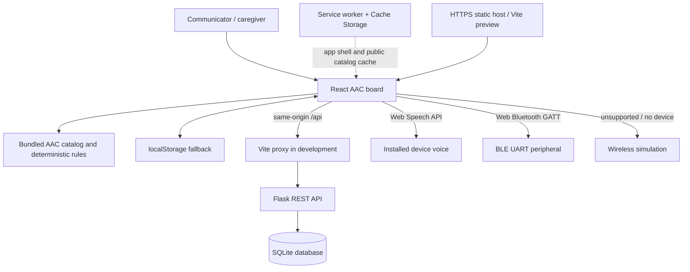
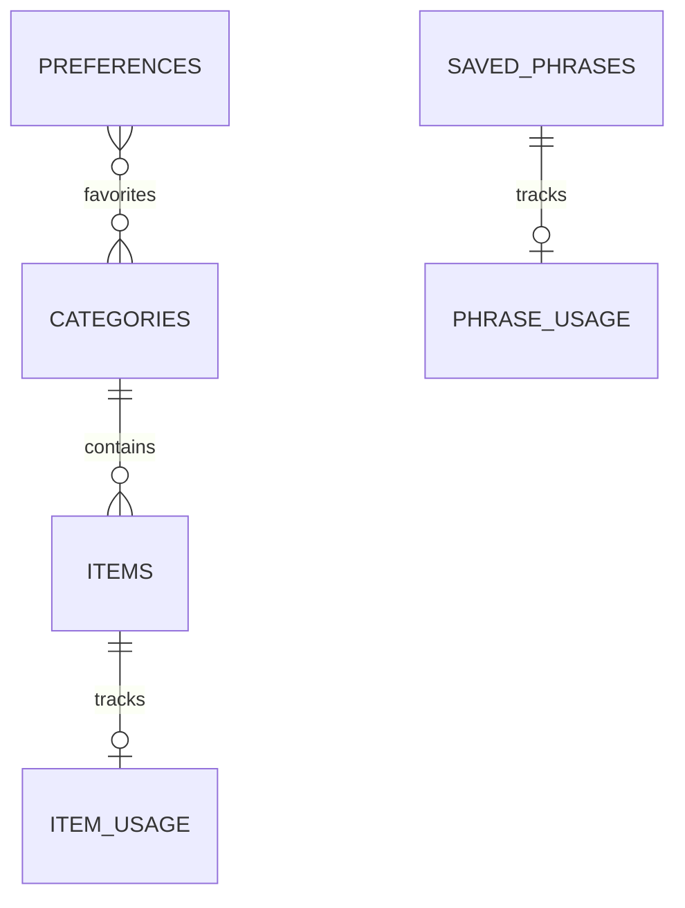

# Saathi AAC system architecture

## Frontend

`src/ui/App.jsx` retains the existing communication board, phrase library, preferences, localStorage fallback, and responsive presentation. `src/data/content.js` is the browser's immediate offline catalog. API access lives in `src/data/api.js`. The app loads the backend catalog and user state in parallel; if an API request fails, the locally bundled board remains available. Local-only phrase changes are merged with server phrases when connectivity returns.

## API and storage

`backend/app.py` implements JSON REST endpoints and per-request SQLite connections. The API listens on loopback by default. Development uses Vite's same-origin `/api` proxy. Production should route `/api` through an HTTPS reverse proxy to Waitress (`backend/serve.py`). CORS is an explicit allowlist for deployments where the API is accessed directly cross-origin.

The preferences-to-categories favorites relation is serialized as a validated list in the single-profile preferences row. `backend/seed.json` contains category and item records, phrase starters, and recommendation rules. It is generated from `src/data/content.js` to keep the API seed in step with the local catalog.

## API routes

- `GET /api/health`
- `GET /api/categories`, `GET /api/items`
- `GET/POST /api/phrases`, `DELETE /api/phrases/<id>`
- `GET/PUT /api/preferences`
- `GET/POST /api/usage`
- `GET /api/suggestions?message=...&language=...`

Inputs are type and length checked. Values are passed to SQLite as parameters. SQLite foreign keys enforce catalog and usage relationships. API exceptions return concise JSON errors rather than tracebacks.

## Recommendation layer

The shared rules map handles “I want”, “I need”, and “I am”. The browser applies local item counts for immediate ranking. The API applies SQLite item counts and appends relevant saved phrases the user has used before. Unknown contexts return no recommendations. No text is sent to an external model. The suggestions API response is not cached, so message text does not become a Cache Storage URL.

## Speech component

The board passes a completed sentence to `SpeechSynthesisUtterance`, sets `en-IN`, `hi-IN`, or `kn-IN`, tries a matching installed voice, then tries the requested language or the device default voice. Speech synthesis is provided by the user's browser/OS and may not be available offline or in every locale.

## Offline/PWA component

`public/sw.js` installs after the production app is first loaded on HTTPS or localhost. It caches the index, referenced JavaScript/CSS assets, manifest/icon, and successful public category/item API responses. On later offline navigation it returns the cached root app. AAC vocabulary and recommendation rules also ship in the JavaScript bundle, so core board use does not require cacheable API data. Preferences, phrases, and usage stay in localStorage as an offline fallback; those updates are reconciled to SQLite when connectivity returns. Private phrase/preferences responses are intentionally not cached in Cache Storage.

The automated worker harness simulates install, cache, and failed network fetches. A browser/device network toggle was not available for this run, so device-level offline behavior remains a deployment smoke test.

## Wireless component

The settings page checks for `navigator.bluetooth`. The physical path requires HTTPS/localhost, a user gesture, a compatible BLE peripheral exposing the Nordic UART Service, and browser permission to select it. On connection, Saathi obtains the service and TX characteristic, writes the sentence bytes, watches GATT disconnect, and disconnects when leaving the settings view. Unsupported browsers show a clear message and can enter Wireless Demo/Simulation mode. Simulation status and sends are explicitly marked as simulated. No real peripheral was available in this development environment, so only code paths and the simulation design could be reviewed.

## Security boundaries

This is a single-profile local/demo application with no authentication. Default loopback binding and restrictive CORS reduce accidental exposure, but do not constitute public multi-user security. A public deployment must add authentication, per-user database rows, TLS, rate limits, and operational database backups. Text is rendered through React's escaped text path; no raw HTML rendering is used. Production preview headers include a restrictive Content Security Policy and frame/content/referrer protections.
